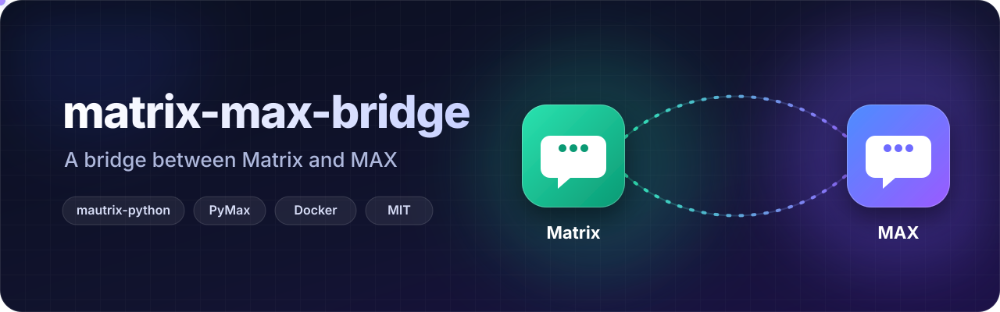
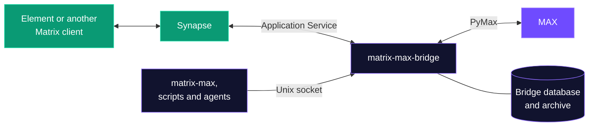

<p align="center">
  
</p>

<p align="center">
  <a href="https://github.com/rodmanvictor/matrix-max-bridge/actions/workflows/ci.yml"></a>
  <a href="CHANGELOG.md"></a>
  <a href="LICENSE"></a>
  
  <a href="docs/installation-docker.md"></a>
</p>

<p align="center">
  <a href="README.md">Русский</a> · <b>English</b>
</p>

<p align="center">
  Your MAX chats in&nbsp;Element or any other Matrix client: direct chats, groups, channels and&nbsp;media.<br>
  Plus a&nbsp;searchable archive, scheduled messages and a&nbsp;local API for scripts and&nbsp;AI&nbsp;agents.
</p>

<p align="center">
  <a href="#quick-start">Quick start</a> ·
  <a href="#features">Features</a> ·
  <a href="#logging-in-to-max">Logging in</a> ·
  <a href="#api-for-scripts-and-agents">API</a> ·
  <a href="#documentation">Documentation</a>
</p>

> [!NOTE]
> This project is not affiliated with MAX, VK, the Matrix.org Foundation or Element. It uses the unofficial MAX client protocol, so changes on the MAX side may require a bridge update. The bot, the detailed guides and most messages are in Russian, since MAX is a Russian messenger.

## Why

MAX lives in its own app. With the bridge, its chats sit next to the rest of your conversations in Matrix: one client on every device, history on your own Synapse server. For automation the bridge exposes a local API, so a script or an agent can find the right conversation, read its history and schedule a message.

## Features

<table>
<tr>
<td width="50%" valign="top">

**🔐 QR login**<br>
You scan the code with the MAX app straight from a terminal on the server. Codes and passwords never pass through Matrix and never end up in room history.

</td>
<td width="50%" valign="top">

**🗂️ Archive and search**<br>
The bridge keeps messages, contacts and chats in its database. You can index the history of selected chats on demand and search it.

</td>
</tr>
<tr>
<td width="50%" valign="top">

**⏰ Scheduled messages**<br>
Text, photos, videos and files are queued by MAX itself. The message goes out even if the bridge is down at that moment.

</td>
<td width="50%" valign="top">

**🤖 API for agents**<br>
A local HTTP API over a Unix socket and the `matrix-max` and `matrix-agent` tools. Search, history, attachments and sending, all answers in JSON.

</td>
</tr>
</table>

What the bridge carries:

| | Matrix → MAX | MAX → Matrix |
|---|:---:|:---:|
| Text | ✅ | ✅ |
| Photos, audio, voice messages, files | ✅ | ✅ |
| Video | ✅ | ✅ including MPEG-DASH → MP4 |
| Replies and quotes | ✅ | ✅ |
| Reactions | ✅ | ⚠️ experimental |
| Direct chats by phone number | ✅ | — |
| Groups and channels | ✅ | ✅ |
| Joining by invite link | ✅ | — |
| Leaving and locally blocking a chat | ✅ | — |
| Contact's phone in the direct chat topic | — | ✅ if MAX provides it |

## How it works



- Every Matrix user connects their own MAX account; sessions are stored separately.
- A direct chat is a room with a "ghost" user `@max_<id>:your-domain`.
- By default the bridge bot posts group messages with the author's name in the text, so the bridge does not register a Matrix user for every member of a large group.

## Quick start

You need Synapse with access to its Application Service configuration, Docker with Compose, and Linux.

**1. Get the bridge and prepare the config**

```bash
git clone https://github.com/rodmanvictor/matrix-max-bridge.git
cd matrix-max-bridge
cp .env.example .env
mkdir -p data
cp example-config.yaml data/config.yaml
```

In `data/config.yaml` set your Matrix domain, the Synapse address, the Application Service address and user permissions. All options are described in [docs/configuration.md](docs/configuration.md) (in Russian).

**2. Generate the registration file**

```bash
docker compose build
docker compose run --rm mautrix-max python -m mautrix_max -g \
  -c /opt/mautrix-max/data/config.yaml \
  -r /opt/mautrix-max/data/registration.yaml
```

**3. Add the registration to Synapse** in `homeserver.yaml` and restart Synapse:

```yaml
app_service_config_files:
  - /path/to/matrix-max-bridge/data/registration.yaml
```

**4. Start the bridge**

```bash
docker compose up -d
docker compose logs -f mautrix-max
```

**5. Log in to MAX** with a QR code as described below.

The full guide with Docker networks, PostgreSQL and upgrades is in [docs/installation-docker.md](docs/installation-docker.md); running without Docker is covered in [docs/installation-systemd.md](docs/installation-systemd.md). Both are in Russian.

## Logging in to MAX

You log in from an interactive terminal on the server, not from a Matrix chat, so codes and passwords never end up in room history.

```bash
docker compose exec -e MAX_AUTH_MXID=@you:example.org \
  -e MAX_DATA_DIR=/opt/mautrix-max/data \
  mautrix-max python -m mautrix_max.qr_cli
```

1. Scan the QR code in the terminal with the MAX app on your phone.
2. If two-factor protection is on, enter the password. It is not echoed.
3. The bridge picks up the new session within 15 seconds. Check it with `!max ping` in the chat with `@maxbot:your-domain`.

> [!TIP]
> Your Matrix ID needs the `user` or `admin` level in `bridge.permissions`. `MAX_DATA_DIR` is the directory that contains `sessions/` from `bridge.max.session_dir`.

> [!WARNING]
> The tool never overwrites an existing session. After `!max logout` a directory with the device profile stays in `data/sessions/`: move it to a backup before logging in again.

## Bot commands

Send the commands in a direct chat with the bridge bot.

| Command | What it does |
|---|---|
| `!max login` | Reminds you how to log in with a QR code |
| `!max logout` | Ends the MAX session |
| `!max ping` | Checks the bridge and the login |
| `!max add +79991234567` | Creates or opens a direct chat by phone number |
| `!max contact [MAX ID]` | Shows the name, MAX ID and phone, if available |
| `!max join <link>` | Joins a group or channel by invite link |
| `!max syncgroups [chat_id or room_id]` | Checks group rooms and invites |
| `!max leave [chat_id]` | Leaves a MAX group or channel |
| `!max block [chat_id]` | Leaves the chat and leaves again whenever you are re-added |
| `!max unblock [chat_id]` | Removes the local block |
| `!max blocked` | Lists blocked chats |

The full reference is in [docs/commands.md](docs/commands.md) (in Russian).

## API for scripts and agents

The API is off until you name its owner. Add these environment variables to the `mautrix-max` service in `docker-compose.yml` and restart the bridge:

```yaml
MAX_RPC_MXID: "@you:example.org"
MAX_RPC_SOCKET: /opt/mautrix-max/data/run/max.sock
```

The `tools/matrix-max` tool then talks to the bridge over the socket. Only the user running the bridge can open the socket, so run the tool as that user or as root:

```bash
export MATRIX_MAX_SOCKET=$PWD/data/run/max.sock

tools/matrix-max contacts 'Anna'                        # find a contact and its ID
tools/matrix-max history --chat 123456 --pages 1        # recent history of a chat
tools/matrix-max archive-search 'contract' --limit 20   # search the archive
tools/matrix-max send-delayed --chat 0 \
  --at '2026-12-01 09:00' --text-file note.txt          # schedule a message
```

Chat `0` is your own "Saved messages", a safe place to test sending. `send-delayed` reads the time in Moscow time; set another zone with `--tz`. The `tools/matrix-agent` tool uses the standard Matrix API: rooms, history, search, sending text and files.

> [!CAUTION]
> Anyone who can open the socket can read the archive and send messages as you. The socket is created with mode `0600`; do not share it with other containers or users.

Every API method and tool option is described in [API.md](API.md).

## Limitations

- no Matrix end-to-end encryption;
- old history is not imported into Matrix rooms; the archive complements them but does not replace them;
- archive search is incomplete, every answer is marked `partial`;
- edits and deletions are not bridged;
- MAX → Matrix reactions depend on protocol push events and may not arrive;
- inline keyboards and some service attachments of MAX are not shown;
- no double puppeting.

See [ROADMAP.md](ROADMAP.md) for plans (in Russian).

## Security

A MAX session gives full access to the account. Never publish `data/config.yaml`, `data/registration.yaml`, the bridge database, the `data/sessions/` directory, tokens or full debug logs. The archive stores message text, so restrict access to the database and its backups.

Run `python tools/check_release.py` before publishing changes. Report vulnerabilities privately as described in [SECURITY.md](SECURITY.md).

## Documentation

| Document | About |
|---|---|
| [Docker installation](docs/installation-docker.md) | Step-by-step setup, networks, upgrades, backups |
| [systemd installation](docs/installation-systemd.md) | Running without Docker |
| [Configuration](docs/configuration.md) | `config.yaml` options, permissions, databases |
| [Commands](docs/commands.md) | Every bot command |
| [API and tools](API.md) | Local API, `matrix-max`, `matrix-agent` (in English) |
| [Architecture](docs/architecture.md) | Sessions, portals, groups |
| [Troubleshooting](docs/troubleshooting.md) | Common errors and what to do |
| [Changelog](CHANGELOG.md) | What each version brought |

Documents without a note are in Russian.

## Development

```bash
python -m venv .venv
source .venv/bin/activate
python -m pip install --no-build-isolation -e .
python -m unittest discover -s tests -p 'test_*.py'
python tools/check_release.py
```

The tests run offline against fakes. How to propose a change is described in [CONTRIBUTING.md](CONTRIBUTING.md).

## Origin and credits

This project continues [pymatrix-max](https://github.com/NijazKa/pymatrix-max) by NijazKa: the bridge core comes from version 0.12.0 (commit `9aca964`) and is developed separately since then.

<details>
<summary>How it differs from pymatrix-max 0.12.0</summary>

| | pymatrix-max 0.12.0 | matrix-max-bridge 0.14.0 |
|---|---|---|
| MAX login | phone, code and password in a Matrix chat | QR code in a server terminal |
| Archive and search | — | ✅ |
| Local API and tools | — | ✅ |
| Scheduled messages | — | ✅ |
| PyMax | 2.3.1 | 2.5.0 |
| Automated tests | — | ✅ |

Details are in [CHANGELOG.md](CHANGELOG.md).

</details>

Thanks to the projects the bridge is built on:

- [pymatrix-max](https://github.com/NijazKa/pymatrix-max), the original bridge by NijazKa;
- [PyMax](https://github.com/MaxApiTeam/PyMax), the MAX client, vendored in `vendor/pymax`;
- [mautrix-python](https://github.com/mautrix/python), the Matrix bridge framework;
- [FFmpeg](https://ffmpeg.org), which turns MPEG-DASH video into MP4.

## License

[MIT](LICENSE). The license file keeps the copyright lines of NijazKa and of the current author. Notes on PyMax and other components are in [THIRD_PARTY_NOTICES.md](THIRD_PARTY_NOTICES.md).

<p align="center"><sub>If the project helps you, give it a ⭐ — it makes it easier for others to find.</sub></p>
