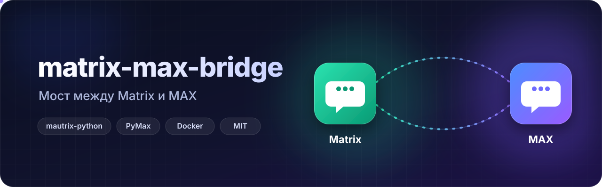
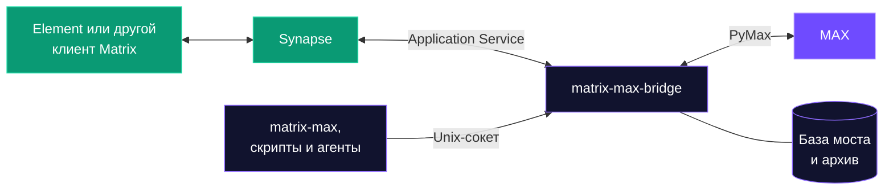

<p align="center">
  
</p>

<p align="center">
  <a href="https://github.com/rodmanvictor/matrix-max-bridge/actions/workflows/ci.yml"></a>
  <a href="https://github.com/rodmanvictor/matrix-max-bridge/releases"></a>
  <a href="LICENSE"></a>
  
  <a href="docs/installation-docker.md"></a>
</p>

<p align="center">
  <b>Русский</b> · <a href="README.en.md">English</a>
</p>

<p align="center">
  Чаты MAX в&nbsp;Element и&nbsp;любом другом клиенте Matrix: личные переписки, группы, каналы и&nbsp;медиа.<br>
  А&nbsp;ещё архив с&nbsp;поиском, отложенные сообщения и&nbsp;локальный API для скриптов и&nbsp;ИИ-агентов.
</p>

<p align="center">
  <a href="#быстрый-старт">Быстрый старт</a> ·
  <a href="#возможности">Возможности</a> ·
  <a href="#вход-в-max">Вход в MAX</a> ·
  <a href="#api-для-скриптов-и-агентов">API</a> ·
  <a href="#документация">Документация</a>
</p>

> [!NOTE]
> Проект не связан с MAX, VK, Matrix.org Foundation или Element. Он работает через неофициальный клиентский протокол MAX, поэтому изменения на стороне сервиса могут потребовать обновления моста.

## Зачем

MAX живёт в отдельном приложении. С мостом его чаты оказываются рядом с остальной перепиской в Matrix: один клиент на всех устройствах, история на вашем собственном сервере Synapse. Для автоматизации мост открывает локальный API, через который скрипт или агент может найти нужный разговор, прочитать историю и поставить отложенное сообщение.

## Возможности

<table>
<tr>
<td width="50%" valign="top">

**🔐 Вход по QR-коду**<br>
Код сканируется приложением MAX прямо из терминала сервера. Коды и пароли не проходят через Matrix и не остаются в истории комнат.

</td>
<td width="50%" valign="top">

**🗂️ Архив и поиск**<br>
Мост сохраняет сообщения, контакты и чаты в своей базе. Историю нужных чатов можно доиндексировать по запросу и искать по ней.

</td>
</tr>
<tr>
<td width="50%" valign="top">

**⏰ Отложенные сообщения**<br>
Текст, фото, видео и файлы ставятся в очередь средствами самого MAX. Сообщение уйдёт, даже если в этот момент мост выключен.

</td>
<td width="50%" valign="top">

**🤖 API для агентов**<br>
Локальный HTTP API через Unix-сокет и утилиты `matrix-max` и `matrix-agent`. Поиск, история, вложения и отправка, ответы в JSON.

</td>
</tr>
</table>

Что переносит мост:

| | Matrix → MAX | MAX → Matrix |
|---|:---:|:---:|
| Текст | ✅ | ✅ |
| Фото, аудио, голосовые, файлы | ✅ | ✅ |
| Видео | ✅ | ✅ включая MPEG-DASH → MP4 |
| Ответы и цитаты | ✅ | ✅ |
| Реакции | ✅ | ⚠️ экспериментально |
| Личные чаты по номеру телефона | ✅ | — |
| Группы и каналы | ✅ | ✅ |
| Вступление по ссылке | ✅ | — |
| Выход и локальная блокировка чата | ✅ | — |
| Телефон контакта в теме личного чата | — | ✅ если MAX его отдаёт |

## Как это устроено



- Каждый пользователь Matrix подключает свой аккаунт MAX, сессии хранятся раздельно.
- Личный чат — это комната с собеседником-«призраком» `@max_<id>:ваш-домен`.
- Сообщения групп по умолчанию отправляет бот моста с именем автора в тексте, чтобы не регистрировать отдельного пользователя Matrix для каждого участника большой группы.

## Быстрый старт

Нужны Synapse с доступом к настройке Application Service, Docker с Compose и Linux.

**1. Скачайте мост и подготовьте конфигурацию**

```bash
git clone https://github.com/rodmanvictor/matrix-max-bridge.git
cd matrix-max-bridge
cp .env.example .env
mkdir -p data
cp example-config.yaml data/config.yaml
```

В `data/config.yaml` укажите домен Matrix, адрес Synapse, адрес Application Service и права пользователей. Все параметры описаны в [docs/configuration.md](docs/configuration.md).

**2. Создайте файл регистрации**

```bash
docker compose build
docker compose run --rm mautrix-max python -m mautrix_max -g \
  -c /opt/mautrix-max/data/config.yaml \
  -r /opt/mautrix-max/data/registration.yaml
```

**3. Подключите регистрацию к Synapse** в `homeserver.yaml` и перезапустите Synapse:

```yaml
app_service_config_files:
  - /путь/к/matrix-max-bridge/data/registration.yaml
```

**4. Запустите мост**

```bash
docker compose up -d
docker compose logs -f mautrix-max
```

**5. Войдите в MAX** по QR-коду, как описано ниже.

Подробная инструкция с сетями Docker, PostgreSQL и обновлением — в [docs/installation-docker.md](docs/installation-docker.md), установка без Docker — в [docs/installation-systemd.md](docs/installation-systemd.md).

## Вход в MAX

Вход выполняется в интерактивном терминале на сервере, а не в чате Matrix, поэтому коды и пароль не попадают в историю комнат.

```bash
docker compose exec -e MAX_AUTH_MXID=@you:example.org \
  -e MAX_DATA_DIR=/opt/mautrix-max/data \
  mautrix-max python -m mautrix_max.qr_cli
```

1. Отсканируйте QR-код из терминала приложением MAX на телефоне.
2. Если включена двухфакторная защита, введите пароль. Он не отображается на экране.
3. Мост подхватит новую сессию в течение 15 секунд. Проверить можно командой `!max ping` в чате с `@maxbot:ваш-домен`.

Действующую сессию инструмент не перезаписывает. Чтобы войти заново или сменить аккаунт, сначала отправьте боту `!max logout`.

> [!TIP]
> Ваш Matrix ID должен иметь уровень `user` или `admin` в `bridge.permissions`. `MAX_DATA_DIR` — каталог, в котором лежит `sessions/` из `bridge.max.session_dir`.

## Команды бота

Команды отправляются в личный чат с ботом моста.

| Команда | Что делает |
|---|---|
| `!max login` | Напоминает, как войти по QR-коду |
| `!max logout` | Завершает сессию MAX |
| `!max ping` | Проверяет мост и авторизацию |
| `!max add +79991234567` | Создаёт или открывает личный чат по номеру |
| `!max contact [MAX ID]` | Показывает имя, MAX ID и доступный телефон |
| `!max join <ссылка>` | Вступает в группу или канал по ссылке |
| `!max syncgroups [chat_id или room_id]` | Проверяет групповые комнаты и приглашения |
| `!max leave [chat_id]` | Выходит из группы или канала MAX |
| `!max block [chat_id]` | Выходит из чата и автоматически выходит при повторном добавлении |
| `!max unblock [chat_id]` | Снимает локальную блокировку |
| `!max blocked` | Показывает заблокированные чаты |

Полное описание — в [docs/commands.md](docs/commands.md).

## API для скриптов и агентов

API выключен, пока вы не укажете владельца. Добавьте в `docker-compose.yml` переменные окружения сервиса `mautrix-max` и перезапустите мост:

```yaml
MAX_RPC_MXID: "@you:example.org"
MAX_RPC_SOCKET: /opt/mautrix-max/data/run/max.sock
```

После этого утилита `tools/matrix-max` работает с мостом через сокет. Сокет доступен только пользователю процесса моста, поэтому запускайте утилиту от его имени или от root:

```bash
export MATRIX_MAX_SOCKET=$PWD/data/run/max.sock

tools/matrix-max contacts 'Анна'                        # найти контакт и его ID
tools/matrix-max history --chat 123456 --pages 1        # свежая история чата
tools/matrix-max archive-search 'договор' --limit 20    # поиск по архиву
tools/matrix-max send-delayed --chat 0 \
  --at '2026-12-01 09:00' --text-file note.txt          # отложенное сообщение
```

Чат с номером `0` — ваше «Избранное», на нём удобно проверять отправку. Время для `send-delayed` указывается по Москве, другую зону задаёт `--tz`. Утилита `tools/matrix-agent` работает через стандартный Matrix API: комнаты, история, поиск, отправка текста и файлов.

> [!CAUTION]
> Любой, кто может открыть сокет, читает архив и пишет от вашего имени. Сокет создаётся с правами `0600`, не открывайте к нему доступ другим контейнерам и пользователям.

Все методы API и параметры утилит описаны в [API.md](API.md).

## Ограничения

- сквозное шифрование Matrix не поддерживается;
- старая история не переносится в комнаты Matrix, архив дополняет их, но не заменяет;
- поиск по архиву неполный, все ответы помечены `partial`;
- редактирование и удаление сообщений не переносятся;
- реакции MAX → Matrix зависят от push-событий протокола и могут не приходить;
- inline-клавиатуры и часть служебных вложений MAX не отображаются;
- double puppeting не реализован.

Планы развития — в [ROADMAP.md](ROADMAP.md).

## Безопасность

Сессия MAX даёт полный доступ к аккаунту. Никогда не публикуйте `data/config.yaml`, `data/registration.yaml`, базу моста, каталог `data/sessions/`, токены и полные отладочные логи. Архив хранит тексты сообщений, поэтому доступ к базе и её резервным копиям нужно ограничить.

Перед публикацией изменений запустите `python tools/check_release.py`. Об уязвимостях сообщайте приватно, как описано в [SECURITY.md](SECURITY.md).

## Документация

| Документ | О чём |
|---|---|
| [Установка через Docker](docs/installation-docker.md) | Пошаговая установка, сети, обновление, резервные копии |
| [Установка через systemd](docs/installation-systemd.md) | Запуск без Docker |
| [Настройка](docs/configuration.md) | Параметры `config.yaml`, права, базы данных |
| [Команды](docs/commands.md) | Все команды бота |
| [API и утилиты](API.md) | Локальный API, `matrix-max`, `matrix-agent` (на английском) |
| [Архитектура](docs/architecture.md) | Сессии, порталы, группы |
| [Решение проблем](docs/troubleshooting.md) | Частые ошибки и что с ними делать |
| [Журнал изменений](CHANGELOG.md) | Что вошло в каждую версию |

## Разработка

```bash
python -m venv .venv
source .venv/bin/activate
python -m pip install --no-build-isolation -e .
python -m unittest discover -s tests -p 'test_*.py'
python tools/check_release.py
```

Тесты работают без сети, на подставных объектах. Как предложить изменение, описано в [CONTRIBUTING.md](CONTRIBUTING.md).

## Происхождение и благодарности

Проект продолжает [pymatrix-max](https://github.com/NijazKa/pymatrix-max) от NijazKa: основа моста взята из версии 0.12.0 (коммит `9aca964`), дальше он развивается отдельно.

<details>
<summary>Чем отличается от pymatrix-max 0.12.0</summary>

| | pymatrix-max 0.12.0 | matrix-max-bridge 0.14 |
|---|---|---|
| Вход в MAX | телефон, код и пароль в чате Matrix | QR-код в терминале сервера |
| Архив и поиск | — | ✅ |
| Локальный API и утилиты | — | ✅ |
| Отложенные сообщения | — | ✅ |
| PyMax | 2.3.1 | 2.5.0 |
| Автотесты | — | ✅ |

Подробности — в [CHANGELOG.md](CHANGELOG.md).

</details>

Спасибо авторам проектов, на которых держится мост:

- [pymatrix-max](https://github.com/NijazKa/pymatrix-max) — исходный мост, NijazKa;
- [PyMax](https://github.com/MaxApiTeam/PyMax) — клиент MAX, вшит в `vendor/pymax`;
- [mautrix-python](https://github.com/mautrix/python) — фреймворк мостов Matrix;
- [FFmpeg](https://ffmpeg.org) — сборка видео MPEG-DASH в MP4.

## Лицензия

[MIT](LICENSE). В файле лицензии сохранены строки авторского права NijazKa и текущего автора. Сведения о PyMax и других компонентах — в [THIRD_PARTY_NOTICES.md](THIRD_PARTY_NOTICES.md).

<p align="center"><sub>Если проект пригодился, поставьте ⭐ — так его проще найти другим.</sub></p>
